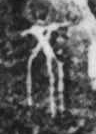

# 不

> 抽象类 · 商 · 难度 ★

| 甲骨形（示意） | 原拓片（真骨片） |
|:---:|:---:|
|  |  |

**今字**：不

## 解析
甲骨文的「不」是人（木）上两叉之形，像否定、违背之象。
这是「不」之象——以人上两叉（违背常理）之形为字。卜辞中「不」多表否定（如「王不田」即王不出田猎）。
后引申为「不是」「不对」「不必」等义，是最常用的否定字。

## 出处
《甲骨文合集》不字诸条（S1）；通行甲骨形见《甲骨文字典》「不」部（S2）。

原拓片图：KLOBIP/OBIMD 甲骨文铭文多模态数据集（S6，CC-BY-4.0），主字 h2mhpxskhk。
