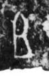

# 且

> 抽象类 · 商 · 难度 ★

| 甲骨形（示意） | 原拓片（真骨片） |
|:---:|:---:|
|  |  |

**今字**：且

## 解析
甲骨文的「且」是连词字，像框口之形。
这是「且」之象——以框口为字，表示连词「且」（并且、而且）。卜辞中「且」常用作连词。
后引申为「且」等义。

## 出处
《甲骨文合集》且字诸条（S1）；通行甲骨形见《甲骨文字典》「且」部（S2）。

原拓片图：KLOBIP/OBIMD 甲骨文铭文多模态数据集（S6，CC-BY-4.0），主字 z640bkv6r7。
