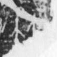

# 並

> 抽象类 · 商 · 难度 ★★★

| 甲骨形（示意） | 原拓片（真骨片） |
|:---:|:---:|
|  |  |

**今字**：並

## 解析
甲骨文的「並」是连词字，像双人之形。
这是「並」之象——以双人（并列）为字，表示连词「並」（并且、而且）。卜辞中「並」出现极少，具体含义待考。
后引申为「並」等义。

## 出处
《甲骨文合集》並字诸条（S1）；通行甲骨形见《甲骨文字典》「並」部（S2）。

原拓片图：KLOBIP/OBIMD 甲骨文铭文多模态数据集（S6，CC-BY-4.0），主字 xmfpjivigx。
