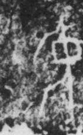

# 中

> 抽象类 · 商 · 难度 ★

| 甲骨形（示意） | 原拓片（真骨片） |
|:---:|:---:|
|  |  |

**今字**：中

## 解析
甲骨文的「中」是一个圆圈（或方框）中间一竖贯穿，表示「在中间」。这是会意字——
一竖贯穿圆圈，表示正中。后来中字不变，楷书定为「中」。中、仲、忠、种、种等字
皆从「中」。「中」是最基本的方位词，也引申为「适中」「不偏不倚」。

## 出处
《甲骨文合集》中字诸条（S1）；通行甲骨形见《甲骨文字典》「中」部（S2）。

原拓片图：KLOBIP/OBIMD 甲骨文铭文多模态数据集（S6，CC-BY-4.0），主字 knps4jrxz3。