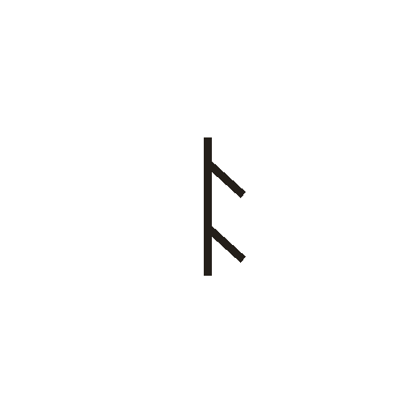
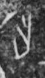

# 乍

> 抽象类 · 商 · 难度 ★

| 甲骨形（示意） | 原拓片（真骨片） |
|:---:|:---:|
|  |  |

**今字**：乍

## 解析
甲骨文的「乍」是虚词字，像人形之形。
这是「乍」之象——以人形为字，表示虚词「乍」（突然、忽然）。卜辞中「乍」常用作虚词。
后引申为「乍」等义。

## 出处
《甲骨文合集》乍字诸条（S1）；通行甲骨形见《甲骨文字典》「乍」部（S2）。

原拓片图：KLOBIP/OBIMD 甲骨文铭文多模态数据集（S6，CC-BY-4.0），主字 c7qvt9bwt5。
