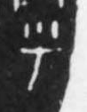

# 乎

> 抽象类 · 商 · 难度 ★

| 甲骨形（示意） | 原拓片（真骨片） |
|:---:|:---:|
|  |  |

**今字**：乎

## 解析
甲骨文的「乎」是虚词字，像横点之形。
这是「乎」之象——以横点为字，表示虚词「乎」（关于、是否）。卜辞中「乎」常用作虚词。
后引申为「乎」等义。

## 出处
《甲骨文合集》乎字诸条（S1）；通行甲骨形见《甲骨文字典》「乎」部（S2）。

原拓片图：KLOBIP/OBIMD 甲骨文铭文多模态数据集（S6，CC-BY-4.0），主字 1s5t2e9cdw。
