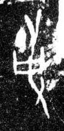

# 事

> 抽象类 · 商 · 难度 ★

| 甲骨形（示意） | 原拓片（真骨片） |
|:---:|:---:|
|  |  |

**今字**：事

## 解析
甲骨文的「事」是名词字，像框口之形。
这是「事」之象——以框口为字，表示名词「事」（事情、事务）。卜辞中「事」常用作名词。
后引申为「事」等义。

## 出处
《甲骨文合集》事字诸条（S1）；通行甲骨形见《甲骨文字典》「事」部（S2）。

原拓片图：KLOBIP/OBIMD 甲骨文铭文多模态数据集（S6，CC-BY-4.0），主字 h3nw474wwr。
