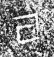

# 亘

> 抽象类 · 商 · 难度 ★

| 甲骨形（示意） | 原拓片（真骨片） |
|:---:|:---:|
|  |  |

**今字**：亘

## 解析
甲骨文的「亘」是形容词字，像横框之形。
这是「亘」之象——以横框为字，表示形容词「亘」（连续、贯通）。卜辞中「亘」常用作形容词。
后引申为「亘」等义。

## 出处
《甲骨文合集》亘字诸条（S1）；通行甲骨形见《甲骨文字典》「亘」部（S2）。

原拓片图：KLOBIP/OBIMD 甲骨文铭文多模态数据集（S6，CC-BY-4.0），主字 kkt3pdctdg。
