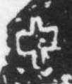

# 亞

> 抽象类 · 商 · 难度 ★★★

| 甲骨形（示意） | 原拓片（真骨片） |
|:---:|:---:|
|  |  |

**今字**：亞

## 解析
甲骨文的「亞」是形容词字，像双人之形。
这是「亞」之象——以双人为字，表示形容词「亞」（次等、次于）。卜辞中「亞」出现极少，具体含义待考。
后引申为「亞」等义。

## 出处
《甲骨文合集》亞字诸条（S1）；通行甲骨形见《甲骨文字典》「亞」部（S2）。

原拓片图：KLOBIP/OBIMD 甲骨文铭文多模态数据集（S6，CC-BY-4.0），主字 nmwnjd5u4n。
