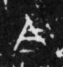

# 今

> 抽象类 · 商 · 难度 ★

| 甲骨形（示意） | 原拓片（真骨片） |
|:---:|:---:|
|  |  |

**今字**：今

## 解析
甲骨文的「今」是时间字，像人冠之形。
这是「今」之象——以人冠为字，表示时间「今」（现在、今天）。卜辞中「今」常用作时间词。
后引申为「今」等义。

## 出处
《甲骨文合集》今字诸条（S1）；通行甲骨形见《甲骨文字典》「今」部（S2）。

原拓片图：KLOBIP/OBIMD 甲骨文铭文多模态数据集（S6，CC-BY-4.0），主字 ihsuhqgmdc。
