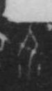

# 介

> 抽象类 · 商 · 难度 ★

| 甲骨形（示意） | 原拓片（真骨片） |
|:---:|:---:|
|  |  |

**今字**：介

## 解析
甲骨文的「介」是介词字，像人冠之形。
这是「介」之象——以人冠为字，表示介词「介」（介于、介于两者之间）。卜辞中「介」常用作介词。
后引申为「介」等义。

## 出处
《甲骨文合集》介字诸条（S1）；通行甲骨形见《甲骨文字典》「介」部（S2）。

原拓片图：KLOBIP/OBIMD 甲骨文铭文多模态数据集（S6，CC-BY-4.0），主字 lr27sngh2z。
