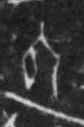

# 以

> 抽象类 · 商 · 难度 ★

| 甲骨形（示意） | 原拓片（真骨片） |
|:---:|:---:|
|  |  |

**今字**：以

## 解析
甲骨文的「以」是介词字，像人冠之形。
这是「以」之象——以人冠为字，表示介词「以」（用、拿、把）。卜辞中「以」常用作介词。
后引申为「以」等义。

## 出处
《甲骨文合集》以字诸条（S1）；通行甲骨形见《甲骨文字典》「以」部（S2）。

原拓片图：KLOBIP/OBIMD 甲骨文铭文多模态数据集（S6，CC-BY-4.0），主字 5n30uigzj6。
