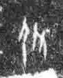

# 伊

> 抽象类 · 商 · 难度 ★

| 甲骨形（示意） | 原拓片（真骨片） |
|:---:|:---:|
|  |  |

**今字**：伊

## 解析
甲骨文的「伊」是代词字，像人冠之形。
这是「伊」之象——以人冠为字，表示代词「伊」（他、她、彼）。卜辞中「伊」常用作代词。
后引申为「伊」等义。

## 出处
《甲骨文合集》伊字诸条（S1）；通行甲骨形见《甲骨文字典》「伊」部（S2）。

原拓片图：KLOBIP/OBIMD 甲骨文铭文多模态数据集（S6，CC-BY-4.0），主字 jgdbp661hw。
