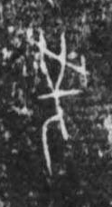

# 先

> 抽象类 · 商 · 难度 ★

| 甲骨形（示意） | 原拓片（真骨片） |
|:---:|:---:|
|  |  |

**今字**：先

## 解析
甲骨文的「先」是动词字，像人冠之形。
这是「先」之象——以人冠为字，表示动词「先」（先于、领先）。卜辞中「先」常用作动词。
后引申为「先」等义。

## 出处
《甲骨文合集》先字诸条（S1）；通行甲骨形见《甲骨文字典》「先」部（S2）。

原拓片图：KLOBIP/OBIMD 甲骨文铭文多模态数据集（S6，CC-BY-4.0），主字 h8exoqnpru。
