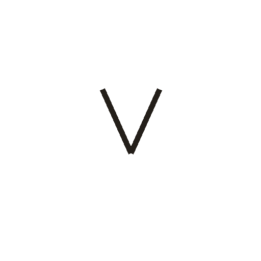
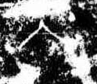

# 入

> 抽象类 · 商 · 难度 ★

| 甲骨形（示意） | 原拓片（真骨片） |
|:---:|:---:|
|  |  |

**今字**：入

## 解析
甲骨文的「入」是一个下尖的倒 V（叉形），像俯身进入之态。
这是「入」之象——从外到内、从上向下，与「出」相对。卜辞中「入」多指进入、收入（如「入三十」即收入三十）。
后引申为「入门」「收入」「入宫」等义。

## 出处
《甲骨文合集》入字诸条（S1）；通行甲骨形见《甲骨文字典》「入」部（S2）。

原拓片图：KLOBIP/OBIMD 甲骨文铭文多模态数据集（S6，CC-BY-4.0），主字 a8n7ywfrd3。
