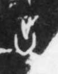

# 出

> 抽象类 · 商 · 难度 ★

| 甲骨形（示意） | 原拓片（真骨片） |
|:---:|:---:|
|  |  |

**今字**：出

## 解析
甲骨文的「出」是竖上加一小叉（或人头部冒出地面之形），像从下往上冒出来的动作。
这是「出」之象——从内到外、从下向上，与「入」相对。卜辞中「出」多指外出、出行（如「王出田」）。
后引申为「支出」「出发」「出色」等义。

## 出处
《甲骨文合集》出字诸条（S1）；通行甲骨形见《甲骨文字典》「出」部（S2）。

原拓片图：KLOBIP/OBIMD 甲骨文铭文多模态数据集（S6，CC-BY-4.0），主字 74alaf1szs。
