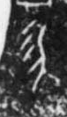

# 勿

> 抽象类 · 商 · 难度 ★

| 甲骨形（示意） | 原拓片（真骨片） |
|:---:|:---:|
|  |  |

**今字**：勿

## 解析
甲骨文的「勿」是禁止之形（圆圈加斜杠），像禁止、不要之象。
这是「勿」之象——以禁止（圆圈 + 斜杠）之形为字。卜辞中「勿」多表禁止（如「勿田」即不要出田猎）。
后引申为「勿扰」「勿忘」「切勿」等义。

## 出处
《甲骨文合集》勿字诸条（S1）；通行甲骨形见《甲骨文字典》「勿」部（S2）。

原拓片图：KLOBIP/OBIMD 甲骨文铭文多模态数据集（S6，CC-BY-4.0），主字 6ewkk2w7r1。
