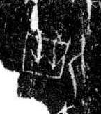

# 北

> 抽象类 · 商 · 难度 ★

| 甲骨形（示意） | 原拓片（真骨片） |
|:---:|:---:|
|  |  |

**今字**：北

## 解析
甲骨文的「北」是二人相背之形（两个人背靠背），像相背、背离之象。
这是「北」之象——以二人相背之形为字。卜辞中「北」多指北方（如「自北来」）。
后引申为「北方」「北边」「背」等义。

## 出处
《甲骨文合集》北字诸条（S1）；通行甲骨形见《甲骨文字典》「北」部（S2）。

原拓片图：KLOBIP/OBIMD 甲骨文铭文多模态数据集（S6，CC-BY-4.0），主字 um3hp76w21。
