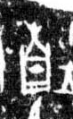

# 南

> 抽象类 · 商 · 难度 ★

| 甲骨形（示意） | 原拓片（真骨片） |
|:---:|:---:|
|  |  |

**今字**：南

## 解析
甲骨文的「南」是木下人（或容器）之形，像南方向阳、草木生长之象。
这是「南」之象——以木下（向阳）之形为字。卜辞中「南」多指南方（如「自南来」）。
后引申为「南方」「南边」「南朝」等义。

## 出处
《甲骨文合集》南字诸条（S1）；通行甲骨形见《甲骨文字典》「南」部（S2）。

原拓片图：KLOBIP/OBIMD 甲骨文铭文多模态数据集（S6，CC-BY-4.0），主字 qmsdu51da8。
