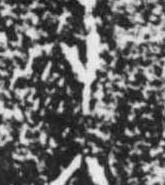

# 卜

> 抽象类 · 商 · 难度 ★

| 甲骨形（示意） | 原拓片（真骨片） |
|:---:|:---:|
|  |  |

**今字**：卜

## 解析
甲骨文的「卜」是灼烧龟甲、兽骨时出现的裂纹：一竖是主裂，旁出一短叉是分支裂。
这是占卜之象——灼骨观裂以问鬼神吉凶。典型的象形字——以灼骨裂纹之形直接为字。
后来裂纹逐渐简化，楷书定为「卜」字。卜、占、贞、卦、契等字皆从「卜」得义。

## 出处
《甲骨文合集》卜字诸条（S1）；通行甲骨形见《甲骨文字典》「卜」部（S2）。

原拓片图：KLOBIP/OBIMD 甲骨文铭文多模态数据集（S6，CC-BY-4.0），主字 h0gzv3styy。
