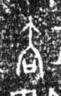

# 去

> 抽象类 · 商 · 难度 ★

| 甲骨形（示意） | 原拓片（真骨片） |
|:---:|:---:|
|  |  |

**今字**：去

## 解析
甲骨文的「去」是「丘」上加一撇（或人往之形），像离去的动作。
这是「去」之象——从内到外、从近到远，与「来」相对。卜辞中「去」多指离去、去除（如「王去田」即王离开田猎）。
后引申为「去掉」「去年」「去处」等义。

## 出处
《甲骨文合集》去字诸条（S1）；通行甲骨形见《甲骨文字典》「去」部（S2）。

原拓片图：KLOBIP/OBIMD 甲骨文铭文多模态数据集（S6，CC-BY-4.0），主字 c13j4nmoij。
