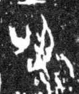

# 名

> 抽象类 · 商 · 难度 ★

| 甲骨形（示意） | 原拓片（真骨片） |
|:---:|:---:|
|  |  |

**今字**：名

## 解析
甲骨文的「名」是口吾之形（一竖加圆圈、一横），像名字。
这是「名」之象——以口吾（报名）之形为字。卜辞中「名」多指名字、名声（如「王赐名」）。
后引申为「名字」「名声」「名义」等义。

## 出处
《甲骨文合集》名字诸条（S1）；通行甲骨形见《甲骨文字典》「名」部（S2）。

原拓片图：KLOBIP/OBIMD 甲骨文铭文多模态数据集（S6，CC-BY-4.0），主字 1axafi8r7u。
