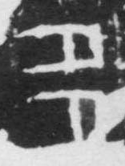

# 多

> 抽象类 · 商 · 难度 ★★

| 甲骨形（示意） | 原拓片（真骨片） |
|:---:|:---:|
|  |  |

**今字**：多

## 解析
甲骨文的「多」是两个「夕」相叠（或并列），表示「数量多」。这是会意字——
以两个「夕」（小）表示「多」。后来两个夕连笔，楷书定为「多」。多、朵、侈、
移等字皆从「多」。「多」与「少」相对，表示数量之大。

## 出处
《甲骨文合集》多字诸条（S1）；通行甲骨形见《甲骨文字典》「多」部（S2）。

原拓片图：KLOBIP/OBIMD 甲骨文铭文多模态数据集（S6，CC-BY-4.0），主字 ex96ntmoie。