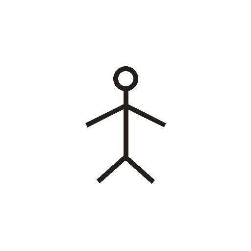

# 大

> 抽象类 · 商 · 难度 ★

**甲骨形**：
**今字**：大

## 解析
甲骨文的「大」是一个张开双臂、双腿的人形，表示「人张大形体」。这是会意字——
以人张形表示「大」。后来大人形简化，楷书定为「大」。大、太、天、失、夺等字
皆从「大」。「大」与「小」相对，表示体积或程度之大。

## 出处
《甲骨文合集》大字诸条（S1）；通行甲骨形见《甲骨文字典》「大」部（S2）。
