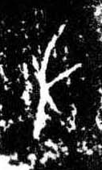

# 左

> 抽象类 · 商 · 难度 ★

| 甲骨形（示意） | 原拓片（真骨片） |
|:---:|:---:|
|  |  |

**今字**：左

## 解析
甲骨文的「左」是左手之形（一竖加一横、一短横），像手向左伸。
这是「左」之象——以左手（左方）之形为字。卜辞中「左」多指左边、左方（与「右」相对）。
后引申为「左边」「左侧」「佐助」等义。

## 出处
《甲骨文合集》左字诸条（S1）；通行甲骨形见《甲骨文字典》「左」部（S2）。

原拓片图：KLOBIP/OBIMD 甲骨文铭文多模态数据集（S6，CC-BY-4.0），主字 c57ck009xt。
