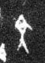

# 文

> 抽象类 · 商 · 难度 ★

| 甲骨形（示意） | 原拓片（真骨片） |
|:---:|:---:|
|  |  |

**今字**：文

## 解析
甲骨文的「文」是纹身之形（一竖加两横），像文字。
这是「文」之象——以纹身（刻画）之形为字。卜辞中「文」多指文字、花纹（如「王作文」）。
后引申为「文字」「文章」「文明」等义。

## 出处
《甲骨文合集》文字诸条（S1）；通行甲骨形见《甲骨文字典》「文」部（S2）。

原拓片图：KLOBIP/OBIMD 甲骨文铭文多模态数据集（S6，CC-BY-4.0），主字 30u8rx4qre。
