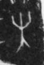

# 未

> 抽象类 · 商 · 难度 ★

| 甲骨形（示意） | 原拓片（真骨片） |
|:---:|:---:|
|  |  |

**今字**：未

## 解析
甲骨文的「未」是木（树）上两叉之形，像尚未成熟、还未发生之象。
这是「未」之象——以木上两叉（尚未结果）之形为字。卜辞中「未」多表尚未（如「未见」即尚未见到）。
后引申为「未来」「未必」「未尝」等义。

## 出处
《甲骨文合集》未字诸条（S1）；通行甲骨形见《甲骨文字典》「未」部（S2）。

原拓片图：KLOBIP/OBIMD 甲骨文铭文多模态数据集（S6，CC-BY-4.0），主字 pa13rewdd9。
