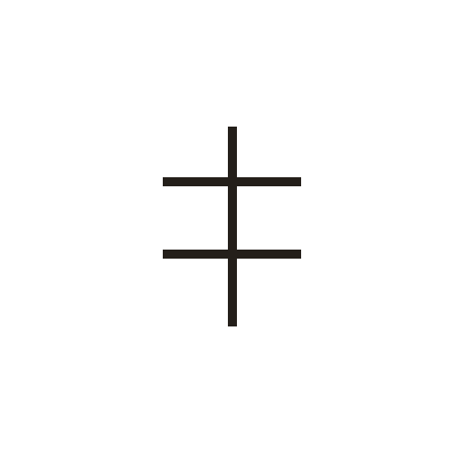
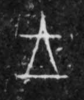

# 王

> 抽象类 · 商 · 难度 ★

| 甲骨形（示意） | 原拓片（真骨片） |
|:---:|:---:|
|  |  |

**今字**：王

## 解析
甲骨文的「王」是一竖加两横（或三横），像权杖、玉钺之形。一竖是器身，横是装饰或象征。
这是王权之象——执钺主政、号令天下，后加一横成「王」，表示至高权力。
卜辞中「王」多指商王（如「王受又寿」「王出人」），是甲骨卜辞里最常见的主语。

## 出处
《甲骨文合集》王字诸条（S1）；通行甲骨形见《甲骨文字典》「王」部（S2）。

原拓片图：KLOBIP/OBIMD 甲骨文铭文多模态数据集（S6，CC-BY-4.0），主字 hftl4m18q0。
