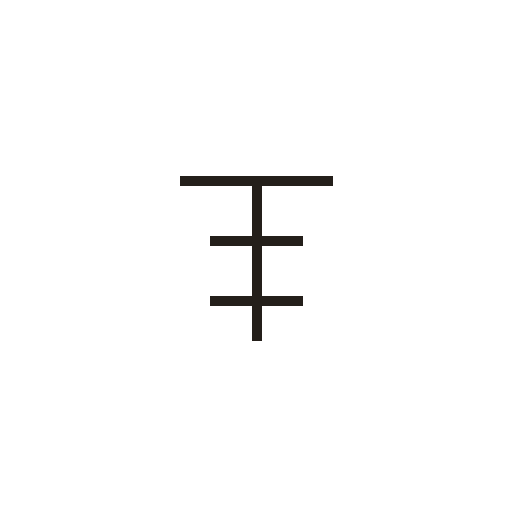
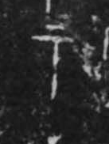

# 示

> 抽象类 · 商 · 难度 ★★

| 甲骨形（示意） | 原拓片（真骨片） |
|:---:|:---:|
|  |  |

**今字**：示

## 解析
甲骨文的「示」是神主祭台的形：上方一横是台顶，中一竖是主柱，两侧短横是陈设的供品。
典型的象形字——以神主祭台之形直接为字。后来祭台简化，加「二」（或「二」形），
至楷书定为「示」字。示、祭、祀、祖、社等字皆从「示」得义。注意与「土」（神位之
下）有别。

## 出处
《甲骨文合集》示字诸条（S1）；通行甲骨形见《甲骨文字典》「示」部（S2）。

原拓片图：KLOBIP/OBIMD 甲骨文铭文多模态数据集（S6，CC-BY-4.0），主字 fom5bv844r。
