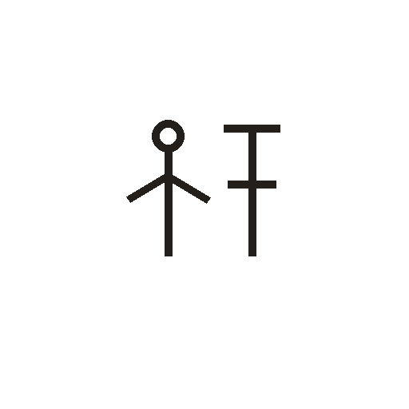
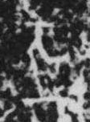

# 祭

> 抽象类 · 商 · 难度 ★★★

| 甲骨形（示意） | 原拓片（真骨片） |
|:---:|:---:|
|  |  |

**今字**：祭

## 解析
甲骨文的「祭」是两人（或一人）朝「示」（祭台/神主）而献祭的形：一侧是人，另一侧
是神主祭台，台上陈供品。会意兼象形——人面向神主献祭。后来人形简化，保留「示」
与「又」（手），加「肉」，至楷书定为「祭」字。祭、祀、祝、祠等字皆从「祭」。

## 出处
《甲骨文合集》祭字诸条（S1）；通行甲骨形见《甲骨文字典》「祭」部（S2）。

原拓片图：KLOBIP/OBIMD 甲骨文铭文多模态数据集（S6，CC-BY-4.0），主字 xjoc12tti2。
