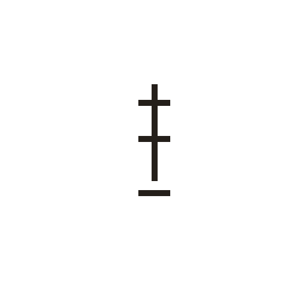
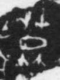

# 莫

> 抽象类 · 商 · 难度 ★

| 甲骨形（示意） | 原拓片（真骨片） |
|:---:|:---:|
|  |  |

**今字**：莫

## 解析
甲骨文的「莫」是暮（日落草莽）下无（无人）之形，像没有人、没有之象。
这是「莫」之象——以暮下无（没有人）之形为字。卜辞中「莫」多表否定（如「莫我」即没有人帮助我）。
后引申为「莫大」「莫名其妙」「莫须有」等义。

## 出处
《甲骨文合集》莫字诸条（S1）；通行甲骨形见《甲骨文字典》「莫」部（S2）。

原拓片图：KLOBIP/OBIMD 甲骨文铭文多模态数据集（S6，CC-BY-4.0），主字 lxao6q3l56。
