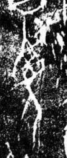

# 西

> 抽象类 · 商 · 难度 ★

| 甲骨形（示意） | 原拓片（真骨片） |
|:---:|:---:|
|  |  |

**今字**：西

## 解析
甲骨文的「西」是鸟巢之形（或木下之巢），像西方日落、鸟归巢之象。
这是「西」之象——以鸟巢（日落方位）之形为字。卜辞中「西」多指西方（如「自西来」）。
后引申为「西方」「西边」「姓西」等义。

## 出处
《甲骨文合集》西字诸条（S1）；通行甲骨形见《甲骨文字典》「西」部（S2）。

原拓片图：KLOBIP/OBIMD 甲骨文铭文多模态数据集（S6，CC-BY-4.0），主字 9ypw4dceci。
