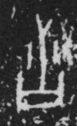

# 言

> 抽象类 · 商 · 难度 ★

| 甲骨形（示意） | 原拓片（真骨片） |
|:---:|:---:|
|  |  |

**今字**：言

## 解析
甲骨文的「言」是口舌之形（圆圈加一横），像言语。
这是「言」之象——以口舌之形为字。卜辞中「言」多指言语、说话（如「王言」）。
后引申为「言语」「言论」「言说」等义。

## 出处
《甲骨文合集》言字诸条（S1）；通行甲骨形见《甲骨文字典》「言」部（S2）。

原拓片图：KLOBIP/OBIMD 甲骨文铭文多模态数据集（S6，CC-BY-4.0），主字 t1wd9fiznl。
