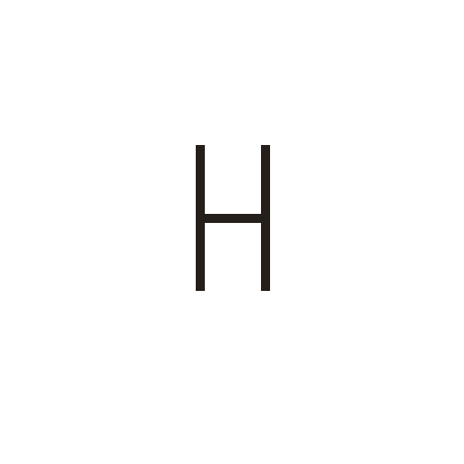
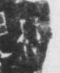

# 非

> 抽象类 · 商 · 难度 ★

| 甲骨形（示意） | 原拓片（真骨片） |
|:---:|:---:|
|  |  |

**今字**：非

## 解析
甲骨文的「非」是二人相背之形（两个人背靠背），像相违、违背之象。
这是「非」之象——以二人相背（相违背）之形为字。卜辞中「非」多表否定（如「非王」即不是王）。
后引申为「不是」「不对」「非常」等义。

## 出处
《甲骨文合集》非字诸条（S1）；通行甲骨形见《甲骨文字典》「非」部（S2）。

原拓片图：KLOBIP/OBIMD 甲骨文铭文多模态数据集（S6，CC-BY-4.0），主字 4j5hjsdkwc。
