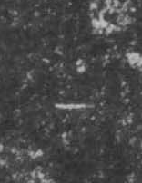

# 一

> 数目类 · 商 · 难度 ★

| 甲骨形（示意） | 原拓片（真骨片） |
|:---:|:---:|
|  |  |

**今字**：一

## 解析
甲骨文的「一」是一横，表示最小的数目。这是典型的象形字——以一根横画直接为字，
是最简单的数词。后来一横不变，楷书定为「一」。一、下、二、三、上、大等字皆从「一」。
「一」是最小的整数，也是一切数的起点。

## 出处
《甲骨文合集》一字诸条（S1）；通行甲骨形见《甲骨文字典》「一」部（S2）。

原拓片图：KLOBIP/OBIMD 甲骨文铭文多模态数据集（S6，CC-BY-4.0），主字 jrzjjh3g1r。