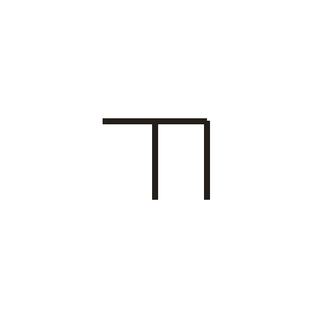
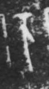

# 万

> 数目类 · 商 · 难度 ★

| 甲骨形（示意） | 原拓片（真骨片） |
|:---:|:---:|
|  |  |

**今字**：万

## 解析
甲骨文的「万」是数目字，像横折竖之形。
这是「万」之象——以横折竖为字，表示数目「万」。卜辞中「万」常用作数目。
后引申为「万」等义。

## 出处
《甲骨文合集》万字诸条（S1）；通行甲骨形见《甲骨文字典》「万」部（S2）。

原拓片图：KLOBIP/OBIMD 甲骨文铭文多模态数据集（S6，CC-BY-4.0），主字 q8n2xmqs1o。
