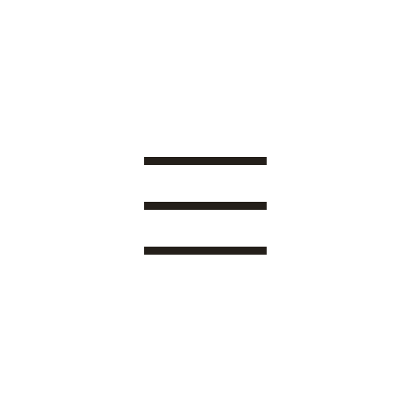
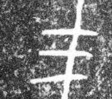

# 三

> 数目类 · 商 · 难度 ★

| 甲骨形（示意） | 原拓片（真骨片） |
|:---:|:---:|
|  |  |

**今字**：三

## 解析
甲骨文的「三」是三横，表示数目三。这是典型的象形字——以三根横画为字。
后来三横不变，楷书定为「三」。三、参、众、品、众等字皆从「三」或含「三」。
「三」在甲骨文中是重要数目，「三」又引申为多。

## 出处
《甲骨文合集》三字诸条（S1）；通行甲骨形见《甲骨文字典》「三」部（S2）。

原拓片图：KLOBIP/OBIMD 甲骨文铭文多模态数据集（S6，CC-BY-4.0），主字 p77d58vew4。