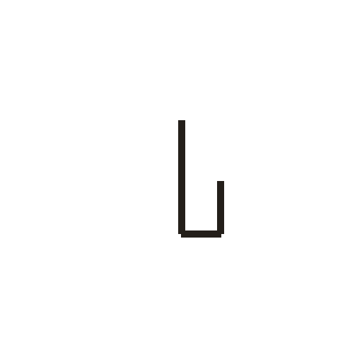
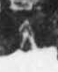

# 丑

> 数目类 · 商 · 难度 ★

| 甲骨形（示意） | 原拓片（真骨片） |
|:---:|:---:|
|  |  |

**今字**：丑

## 解析
甲骨文的「丑」是数目字，像竖折之形。
这是「丑」之象——以竖折为字，表示数目「丑」（十二地支的第二位）。卜辞中「丑」常用作地支纪日。
后引申为「丑」等义。

## 出处
《甲骨文合集》丑字诸条（S1）；通行甲骨形见《甲骨文字典》「丑」部（S2）。

原拓片图：KLOBIP/OBIMD 甲骨文铭文多模态数据集（S6，CC-BY-4.0），主字 0u6c7rk2ux。
