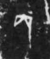

# 丙

> 数目类 · 商 · 难度 ★

| 甲骨形（示意） | 原拓片（真骨片） |
|:---:|:---:|
|  |  |

**今字**：丙

## 解析
甲骨文的「丙」是数目字，像横折之形。
这是「丙」之象——以横折为字，表示数目「丙」（天干的第三位）。卜辞中「丙」常用作天干纪日。
后引申为「丙」等义。

## 出处
《甲骨文合集》丙字诸条（S1）；通行甲骨形见《甲骨文字典》「丙」部（S2）。

原拓片图：KLOBIP/OBIMD 甲骨文铭文多模态数据集（S6，CC-BY-4.0），主字 lp8x647qo2。
