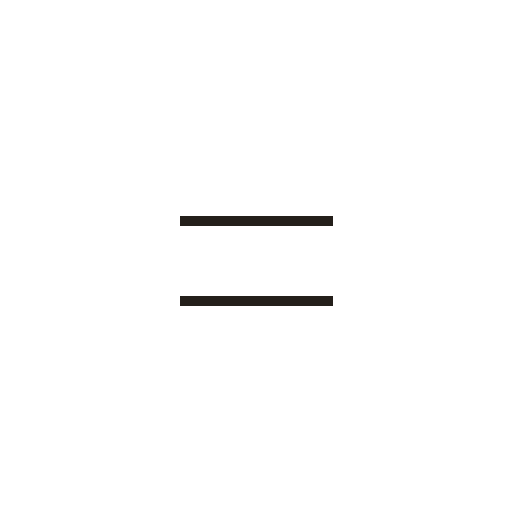
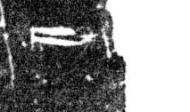

# 二

> 数目类 · 商 · 难度 ★

| 甲骨形（示意） | 原拓片（真骨片） |
|:---:|:---:|
|  |  |

**今字**：二

## 解析
甲骨文的「二」是两横，表示数目二。这是典型的象形字——以两根横画为字。
后来两横不变，楷书定为「二」。二、五、两、双、朋等字皆从「二」或含「二」。
「二」是最小的偶数。

## 出处
《甲骨文合集》二字诸条（S1）；通行甲骨形见《甲骨文字典》「二」部（S2）。

原拓片图：KLOBIP/OBIMD 甲骨文铭文多模态数据集（S6，CC-BY-4.0），主字 8gxzzbv7w8。