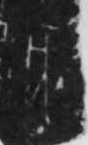

# 亥

> 数目类 · 商 · 难度 ★

| 甲骨形（示意） | 原拓片（真骨片） |
|:---:|:---:|
|  |  |

**今字**：亥

## 解析
甲骨文的「亥」是数目字，像人冠之形。
这是「亥」之象——以人冠为字，表示数目「亥」（十二地支的第十二位）。卜辞中「亥」常用作地支纪日。
后引申为「亥」等义。

## 出处
《甲骨文合集》亥字诸条（S1）；通行甲骨形见《甲骨文字典》「亥」部（S2）。

原拓片图：KLOBIP/OBIMD 甲骨文铭文多模态数据集（S6，CC-BY-4.0），主字 q71z8tnnc6。
