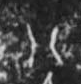

# 八

> 数目类 · 商 · 难度 ★

| 甲骨形（示意） | 原拓片（真骨片） |
|:---:|:---:|
|  |  |

**今字**：八

## 解析
甲骨文的「八」是数目字，像人冠之形。
这是「八」之象——以人冠为字，表示数目「八」（八）。卜辞中「八」常用作数目。
后引申为「八」等义。

## 出处
《甲骨文合集》八字诸条（S1）；通行甲骨形见《甲骨文字典》「八」部（S2）。

原拓片图：KLOBIP/OBIMD 甲骨文铭文多模态数据集（S6，CC-BY-4.0），主字 2r051ups8k。
