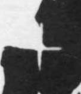

# 十

> 数目类 · 商 · 难度 ★

| 甲骨形（示意） | 原拓片（真骨片） |
|:---:|:---:|
|  |  |

**今字**：十

## 解析
甲骨文的「十」是一横一竖相交（十字），表示数目十。这是典型的象形字——
以十字交画为字。后来十字不变，楷书定为「十」。十、斗、木、本、未等字皆从「十」。
「十」是十进制的单位，甲骨文中极常见。

## 出处
《甲骨文合集》十字诸条（S1）；通行甲骨形见《甲骨文字典》「十」部（S2）。

原拓片图：KLOBIP/OBIMD 甲骨文铭文多模态数据集（S6，CC-BY-4.0），主字 5ntior2ch1。