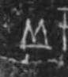

# 丘

> 自然现象类 · 商 · 难度 ★

| 甲骨形（示意） | 原拓片（真骨片） |
|:---:|:---:|
|  |  |

**今字**：丘

## 解析
甲骨文的「丘」是自然字，像两峰之形。
这是「丘」之象——以两峰为字，表示山丘。卜辞中「丘」常用作地名或自然物。
后引申为「丘」等义。

## 出处
《甲骨文合集》丘字诸条（S1）；通行甲骨形见《甲骨文字典》「丘」部（S2）。

原拓片图：KLOBIP/OBIMD 甲骨文铭文多模态数据集（S6，CC-BY-4.0），主字 crd6njmjax。
