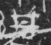

# 丹

> 自然现象类 · 商 · 难度 ★

| 甲骨形（示意） | 原拓片（真骨片） |
|:---:|:---:|
|  |  |

**今字**：丹

## 解析
甲骨文的「丹」是自然字，像框点之形。
这是「丹」之象——以框点为字，表示丹砂。卜辞中「丹」常用作矿物或颜色。
后引申为「丹」等义。

## 出处
《甲骨文合集》丹字诸条（S1）；通行甲骨形见《甲骨文字典》「丹」部（S2）。

原拓片图：KLOBIP/OBIMD 甲骨文铭文多模态数据集（S6，CC-BY-4.0），主字 qtwjt6h6gs。
