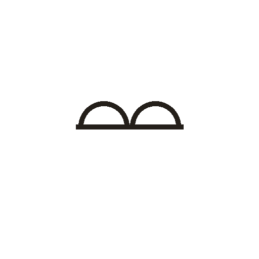
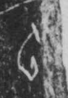

# 云

> 自然现象类 · 商 · 难度 ★★★

| 甲骨形（示意） | 原拓片（真骨片） |
|:---:|:---:|
|  |  |

**今字**：云

## 解析
甲骨文的「云」像两团云气相叠——底下横画是地平线或云之底，上方两个圆弧是
翻卷的云头。云是天上流动的云气，以形为字。后来两个云头简化，上部成「厶」
形，下部「云」形加「雨」头，隶变楷书定为「云」。注意：「云」本义是云气，
后来假借为「说」（言语如云气流动），又假借为「云朵」。

## 出处
《甲骨文合集》云字诸条（S1）；通行甲骨形见《甲骨文字典》「云」部（S2）。

原拓片图：KLOBIP/OBIMD 甲骨文铭文多模态数据集（S6，CC-BY-4.0），主字 zmixmtzym6。