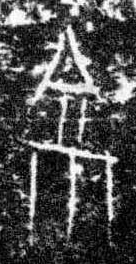

# 京

> 自然现象类 · 商 · 难度 ★

| 甲骨形（示意） | 原拓片（真骨片） |
|:---:|:---:|
|  |  |

**今字**：京

## 解析
甲骨文的「京」是名词字，像人冠之形。
这是「京」之象——以人冠为字，表示名词「京」（京城、首都）。卜辞中「京」常用作地名。
后引申为「京」等义。

## 出处
《甲骨文合集》京字诸条（S1）；通行甲骨形见《甲骨文字典》「京」部（S2）。

原拓片图：KLOBIP/OBIMD 甲骨文铭文多模态数据集（S6，CC-BY-4.0），主字 akt7yld9xk。
