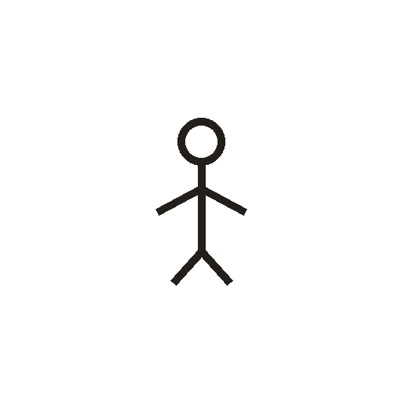
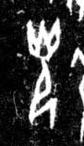

# 光

> 自然现象类 · 商 · 难度 ★

| 甲骨形（示意） | 原拓片（真骨片） |
|:---:|:---:|
|  |  |

**今字**：光

## 解析
甲骨文的「光」是人光光（光芒）之形（圆圈 + 一竖、两臂、两腿），像光芒。
这是「光」之象——以人光光（光芒）之形为字。卜辞中「光」多指光芒（如「王受光」）。
后引申为「光明」「光芒」「光荣」等义。

## 出处
《甲骨文合集》光字诸条（S1）；通行甲骨形见《甲骨文字典》「光」部（S2）。

原拓片图：KLOBIP/OBIMD 甲骨文铭文多模态数据集（S6，CC-BY-4.0），主字 1ttzl6vlzs。
