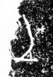

# 土

> 自然现象类 · 商 · 难度 ★

| 甲骨形（示意） | 原拓片（真骨片） |
|:---:|:---:|
|  |  |

**今字**：土

## 解析
甲骨文的「土」是一横加一垂下的竖，像地面与插入地中的标记（或后土之像）。
这是土地、大地之象——以地平面之形为字。卜辞中「土」常指土地、后土神（「土方」即土方国）。
后引申为「泥土」「土壤」「本土」等义。

## 出处
《甲骨文合集》土字诸条（S1）；通行甲骨形见《甲骨文字典》「土」部（S2）。

原拓片图：KLOBIP/OBIMD 甲骨文铭文多模态数据集（S6，CC-BY-4.0），主字 pkibwuo4bv。
