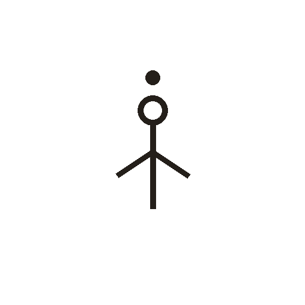

# 天

> 自然现象类 · 商 · 难度 ★★

**甲骨形**：
**今字**：天

## 解析
甲骨文的「天」是人形之上再加一点（或一短横），指人头顶上之极。人是「大」，
头顶之上即「天」。这是以「人之大者」引申为「天地之大」——天是头顶的极限。
后来头部标志突出，人形笔画被省略，头部成圆圈、下面一长竖，楷书定为「天」。
「天」是抽象的方位与宇宙概念，与具体天体（日、月、星）不同。

## 出处
《甲骨文合集》天字诸条（S1）；通行甲骨形见《甲骨文字典》「天」部（S2）。
